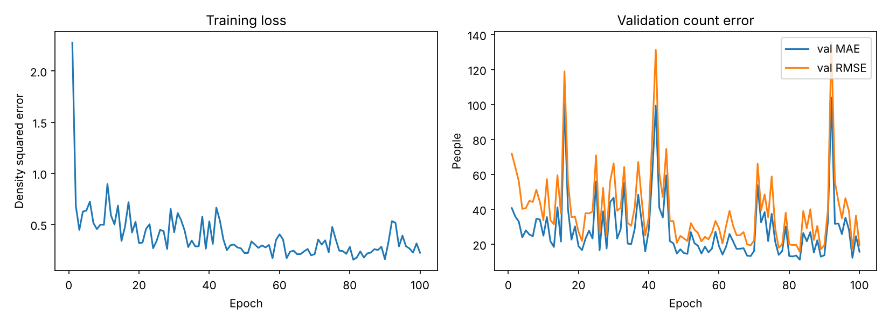
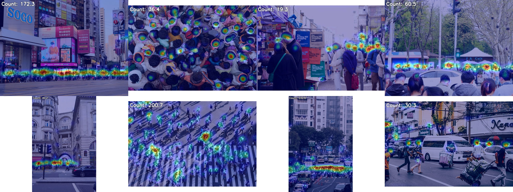

# CrowdStrike: Crowd Counting and Density Estimation

Team CrowdStrike: Prashant Panta, Ronish Karki, Prajwal Kunwar.

We predict a density map for a crowd image; the sum of the map is the estimated
head count. The model is our own TensorFlow/Keras implementation of CSRNet
(Li et al., CVPR 2018), trained and evaluated on ShanghaiTech Part B.

**Result on the Part B test set (316 images):** MAE 11.78, RMSE 17.43
(the paper reports MAE 10.6, RMSE 16.0). Details in [Results](#results-shanghaitech-part-b-test-set-316-images).

## Pipeline at a glance

Run the steps in this order from the repo root. Every script has `--help`.

| # | Step | Command | Inputs | Outputs |
|---|---|---|---|---|
| 1 | Check the dataset | `python scripts/check_dataset.py --part B` | `data/ShanghaiTech/part_B/` (images + `.mat` head annotations) | Console report: `[ok]`/`[FAIL]` per folder, image counts vs. the expected 400 train / 316 test, missing annotations |
| 2 | Build density maps and splits | `python scripts/make_density_maps.py --part B` | Raw images and `.mat` head points | `data/processed/part_B/{train,val,test}/IMG_<n>.npy` (float32 maps, full resolution, each sums to the head count) and `data/processed/part_B/splits.json` (360/40/316) |
| 3 | Train CSRNet | `python src/train.py --part B` | Raw images + processed maps + `splits.json` | `checkpoints/csrnet_partB_best.weights.h5`, `checkpoints/train_log_partB.csv`, `outputs/figures/training_curve_partB.png` |
| 4 | Evaluate | `python src/evaluate.py --weights checkpoints/csrnet_partB_best.weights.h5 --part B --split test` | Trained weights + test split | `outputs/eval_part_B_test.csv`, `outputs/metrics_part_B_test.json`, `outputs/figures/scatter_part_B_test.png`, `outputs/figures/best_worst_part_B_test.png` |
| 5 | Predict on new images | `python src/predict.py --weights checkpoints/csrnet_partB_best.weights.h5 --image demo_images/ --out outputs/demo/` | Trained weights + any image or folder of images | One `<name>_pred.jpg` heatmap overlay per image (count written on it) and `counts.csv` for a folder |
| 6 | Dataset figures | `python scripts/plot_density_examples.py --part B` and `python scripts/plot_data_stats.py --part B` | Raw images + processed maps | `outputs/figures/density_examples.png`, `count_hist_part_B.png`, `pipeline_steps_part_B.png`; per-split count statistics printed |
| 7 | Build the report | `python scripts/build_report.py` | `docs/report/*.md` section files | `docs/report/report.md` |
| – | Tests | `python -m pytest tests -q` | Nothing (data-dependent tests skip if `data/` is missing) | Pass/fail summary |

Steps 4 and 5 can be run without training by downloading our weights
(see [Trained weights](#trained-weights)).

## Project structure

| Path | What it is |
|---|---|
| `src/data/density.py` | Gaussian density-map generation (fixed sigma=15 for Part B, geometry-adaptive for Part A) |
| `src/data/loader.py` | `tf.data` pipeline: ImageNet normalisation, random 1/4-area crops and flips (train), 8x8 sum-pooling of the target |
| `src/data/paths.py` | Where the raw and processed data live |
| `src/model.py` | CSRNet: VGG16 front end (first 10 conv layers) + dilated conv back end, output at 1/8 resolution |
| `src/train.py` | Training loop with validation count MAE, checkpointing and early stopping |
| `src/evaluate.py` | MAE / MSE / RMSE on a split, per-image CSV, plots, mean-count baseline |
| `src/predict.py` | Count people in any image and save a heatmap overlay |
| `src/model_utils.py` | Loads a checkpoint (or an untrained stand-in) for evaluation and prediction |
| `scripts/` | Dataset check, density-map generation, dataset figures, report builder |
| `notebooks/train_colab.ipynb` | End-to-end training on a Colab T4 GPU |
| `tests/` | Unit tests for the data pipeline, evaluation and prediction |
| `docs/CONTRACT.md` | Interface agreement between the data, model and evaluation modules |
| `docs/report/` | Report sections, assembled report (`report.md`) and slide outline |
| `outputs/figures/` | Figures used in the report, including demo predictions |

## Setup

Python 3.10, 3.11 or 3.12 (the pinned TensorFlow 2.15/2.16 does not install on 3.13).
A GPU is only needed for training.

```bash
git clone https://github.com/Prajwal382/CrowdStrike.git
cd CrowdStrike
python -m venv .venv
source .venv/bin/activate        # Windows: .venv\Scripts\activate
pip install -r requirements.txt
python -m pytest tests -q
```

## Data download

The dataset is not in this repo.

1. On Kaggle, search "ShanghaiTech" (dataset by Thai Thien) and choose
   **Download dataset as zip** (about 349 MB). Save it as `archive.zip` in the repo root.
2. Unzip only the dataset folder into `data/`:
   ```bash
   unzip -q archive.zip "ShanghaiTech/*" -d data
   ```
   The scripts expect this layout (`part_B_final` is also accepted):
   ```
   data/ShanghaiTech/part_B/
   ├── train_data/
   │   ├── images/IMG_1.jpg ... IMG_400.jpg
   │   └── ground-truth/GT_IMG_1.mat ... GT_IMG_400.mat
   └── test_data/
       ├── images/IMG_1.jpg ... IMG_316.jpg
       └── ground-truth/GT_IMG_1.mat ... GT_IMG_316.mat
   ```
   Each `.mat` file holds the (x, y) pixel position of every annotated head.
3. Check the folder layout:
   ```bash
   python scripts/check_dataset.py --part B
   ```
4. Build the ground-truth density maps and the fixed 360/40 train/val split (about 6 seconds):
   ```bash
   python scripts/make_density_maps.py --part B
   ```
   Options: `--val-fraction` (default 0.1), `--seed` (default 42), `--overwrite`.

Maps are written to `data/processed/part_B/{train,val,test}/` and the split to
`data/processed/part_B/splits.json`. On Colab, upload only the zip to Google Drive
and rebuild the maps in the notebook; `data/processed` is 2.1 GB.

## Trained weights

The weights file (`csrnet_partB_best.weights.h5`, about 186 MB) is too large for the repo.
Download it from [Google Drive](https://drive.google.com/file/d/1WR1j8Z28lbykctx4AyQBTBiJAoFNIglX/view) and save it as
`checkpoints/csrnet_partB_best.weights.h5`, or train your own with step 3
(about 66 minutes on a Colab T4).

## Train

CSRNet (`src/model.py`): VGG16 front end (first 10 conv layers, ImageNet weights)
plus a dilated back end. Training (`src/train.py`) uses the per-map sum of squared
pixel errors, Adam (lr 1e-5), batch size 8, random 1/4-area crops with horizontal
flips, and keeps the checkpoint with the best validation count MAE (early stopping,
patience 20).

```bash
python src/train.py --part B                     # full training
python src/train.py --smoke --no-pretrained      # 2-epoch pipeline check on random tensors
python src/train.py --part B --resume checkpoints/csrnet_partB_best.weights.h5   # continue after a disconnect
python src/train.py --help                       # all options
```

Main options: `--epochs` (100), `--batch-size` (8), `--lr` (1e-5), `--patience` (20),
`--out-dir` (checkpoints), `--raw-root` / `--processed-root` (data locations).

Outputs in `checkpoints/`: `csrnet_partB_best.weights.h5` and `train_log_partB.csv`
(per-epoch loss, validation MAE and RMSE).
The training curve goes to `outputs/figures/training_curve_partB.png`.

Colab (recommended, T4 GPU): `notebooks/train_colab.ipynb`. Pass
`--out-dir /content/drive/MyDrive/...` so checkpoints survive a disconnect.

Our Part B run: 100 epochs (~40 s each on a T4, about 66 minutes total). Best
validation MAE **11.13** (RMSE 15.63) at epoch 83.



## Evaluate

```bash
# trained model on the Part B test set
python src/evaluate.py --weights checkpoints/csrnet_partB_best.weights.h5 --part B --split test
# mean-count baseline (no model needed)
python src/evaluate.py --baseline
# smoke test with an untrained 1x1-conv model
python src/evaluate.py --dummy --tag untrained
```

`--weights` takes a full saved model (`.keras`/`.h5`) or a weights-only file
(`.weights.h5`, loaded into `build_csrnet()`). It prints a MAE / MSE / RMSE table and writes:

- `outputs/eval_part_B_test.csv`: per-image `image_id, gt, pred, abs_error`
- `outputs/metrics_part_B_test.json`: MAE, MSE, RMSE
- `outputs/figures/scatter_part_B_test.png`: predicted vs ground-truth counts
- `outputs/figures/best_worst_part_B_test.png`: the 5 best and 5 worst images

Use `--raw-root` / `--processed-root` for Colab/Drive paths, `--tag` to name the
output files and `--no-figures` to skip the plots.

## Predict

```bash
python src/predict.py --weights checkpoints/csrnet_partB_best.weights.h5 --image path/to/image.jpg --out outputs/prediction.jpg
python src/predict.py --weights checkpoints/csrnet_partB_best.weights.h5 --image demo_images/ --out outputs/demo/
```

**Input:** one image (`.jpg`, `.jpeg`, `.png`, `.bmp`, `.webp`) or a folder of them.
**Output:** prints the count and saves the image with a density heatmap overlay and the count
written on it. Given a folder, it processes every image and also writes `counts.csv`
(`image, count`).
Images are shrunk so the longest side is at most 1024 pixels (the Part B width)
before inference; change this with `--max-side` (`0` keeps full size, which can
run out of memory on large photos).



## Results (ShanghaiTech Part B, test set, 316 images)

MSE is the mean of squared count errors. RMSE is its square root; crowd-counting
papers report RMSE under the name "MSE".

| Method | MAE | MSE | RMSE |
|---|---|---|---|
| Mean-count baseline (predicts 120.84, the mean train count) | 71.44 | 9058.92 | 95.18 |
| CSRNet (ours, best-val checkpoint) | 11.78 | 303.83 | 17.43 |
| CSRNet (paper, Li et al. 2018) | 10.6 | n/a | 16.0 |

Validation (40 images) for the same checkpoint: MAE 11.13, RMSE 15.63.
Full write-up: [docs/report/report.md](docs/report/report.md)
(rebuild it from the section files with `python scripts/build_report.py`).

## Credits

- Y. Li, X. Zhang, D. Chen. *CSRNet: Dilated Convolutional Neural Networks for
  Understanding the Highly Congested Scenes.* CVPR 2018.
- Y. Zhang, D. Zhou, S. Chen, S. Gao, Y. Ma. *Single-Image Crowd Counting via
  Multi-Column Convolutional Neural Network.* CVPR 2016 (ShanghaiTech dataset).
- ShanghaiTech Kaggle mirror by Thai Thien.
- Demo photos (Unsplash License): Ryoji Iwata, Daniele Colucci, Cheung Yin,
  Fan WU, Dim 7, Viktor Solomonik, Tsuyoshi Kozu and Georg Eiermann on
  [Unsplash](https://unsplash.com). The photos are not stored in this repo;
  only our prediction overlays are.
