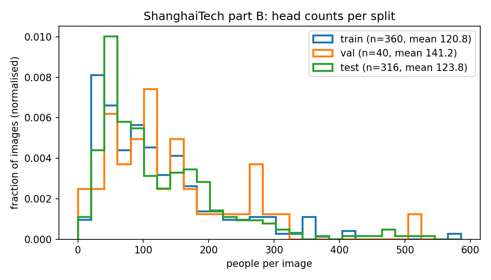
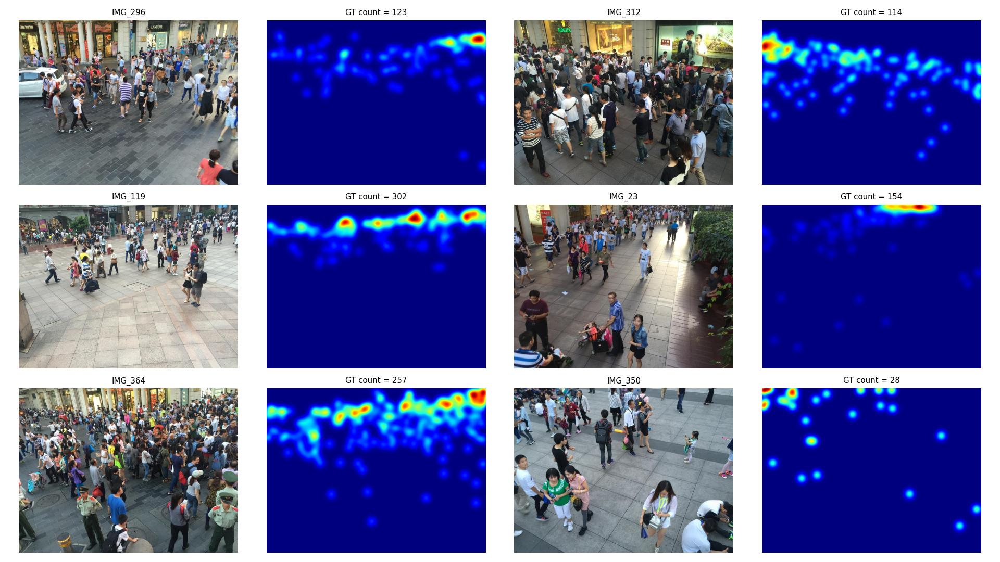
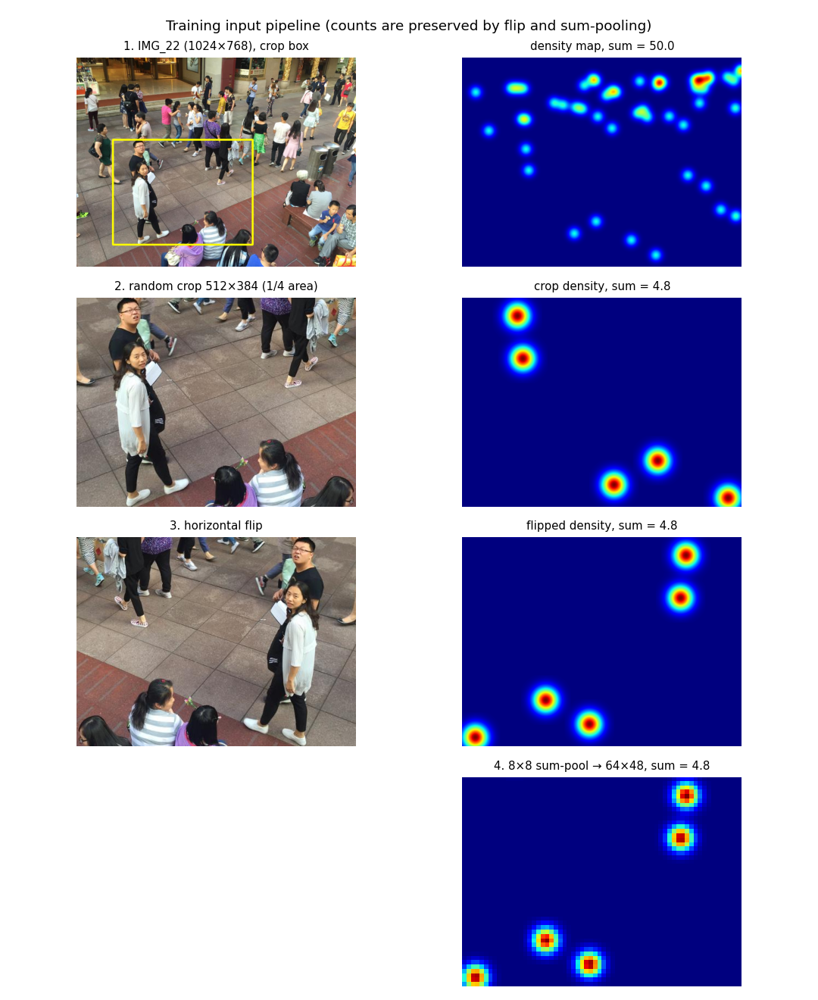

# Dataset and Preprocessing

## Dataset
We use the ShanghaiTech Crowd Counting Dataset (Zhang et al., CVPR 2016).
Each image comes with a `.mat` file listing one (x, y) point per annotated head.

| Part | Train | Test | Typical scene | Resolution |
|------|------:|-----:|---------------|------------|
| B (used) | 400 | 316 | street scenes, sparser crowds | 1024 × 768 |
| A (not used, see below) | 300 | 182 | dense crowds from the web | varies |

We hold out 10% of the official training images as a validation split
(Part B: 360 train / 40 val) with a fixed random seed (42), so every teammate
and every Colab run uses the same split. The ids are saved in
`data/processed/part_B/splits.json`. The test set is used only for final evaluation.

Head counts per image in our Part B splits:

| Split | Images | Total heads | Min | Median | Mean | Max |
|-------|-------:|------------:|----:|-------:|-----:|----:|
| train | 360 | 43,502 | 12 | 96 | 120.8 | 576 |
| val   |  40 |  5,649 | 15 | 117 | 141.2 | 521 |
| test  | 316 | 39,121 |  9 | 93 | 123.8 | 539 |

Train and test have very similar distributions. The 40-image validation split
happens to be somewhat denser (mean 141 vs 121), and with so few images its
MAE is noisy. That is one reason validation and test numbers differ.

## Ground-truth density maps
Counting is framed as density regression. Each head point is replaced by a
2-D Gaussian kernel that integrates to 1, so the integral (sum) of the map
equals the head count.

- **Part B:** fixed kernel, σ = 15 px. Part B crowds are fairly uniform in
  scale, so a fixed σ works well (as in CSRNet).
- **Part A (implemented, not trained):** geometry-adaptive kernel.
  σᵢ = β · d̄ᵢ, where d̄ᵢ is the mean distance to the k = 3 nearest heads
  (via `scipy.spatial.KDTree`) and β = 0.3, so denser regions get narrower
  kernels. Part A training was cut for time.

Kernels are truncated at 3σ. Heads near the border would normally lose part
of their mass outside the image, which lowers the count. We clip each kernel
to the image and renormalise it, so every head still contributes exactly 1.
The generation script refuses to save any map with
|sum − count| / count ≥ 10⁻³. On all 716 Part B images the largest relative
error is 7.4 × 10⁻⁷. Maps are stored as float32 `.npy` files at full image
resolution (2.1 GB for Part B, rebuilt from the dataset in about 6 seconds).

## Input pipeline (`tf.data`)
- **Training:** random crop of 1/4 of the image area (half width × half
  height, i.e. 512 × 384 on Part B), random horizontal flip (p = 0.5),
  applied identically to the image and its density map.
- **Validation/test:** full image, zero-padded on the bottom and right to a
  multiple of 8. Padding adds no density, so counts are unchanged.
- **Normalisation:** RGB scaled to [0, 1], then standardised with the ImageNet
  mean (0.485, 0.456, 0.406) and std (0.229, 0.224, 0.225) to match the
  pretrained VGG-16 front end.
- **Target resolution:** CSRNet outputs a map at 1/8 resolution. We
  downsample the ground truth by **sum-pooling** 8 × 8 blocks, not by
  resizing. Sum-pooling preserves the total count exactly, while bilinear
  resizing would scale it by 1/64.

The figure below follows one training sample through these steps. The crop
contains 4.8 of the image's 50 heads, because heads cut by the crop border
count fractionally. The flip and the sum-pooling both keep that 4.8 exactly.

## Verification
- Unit tests check the count invariant, including heads on or outside
  the image border, and that the split is deterministic and disjoint. They
  also check loader shapes and dtypes, and that the 1/8 targets keep the count.
- A test on 20 random real Part B images checks that each density sum
  matches the number of annotated heads.
- The training-set mean count from our maps (120.8) matches the mean-count
  baseline in the results section (120.84), which was cross-checked against
  the raw annotations.

Figures are reproduced with `python scripts/plot_density_examples.py` and
`python scripts/plot_data_stats.py`.

## Slide bullets

**Slide 3: Dataset**
- ShanghaiTech Part B: 716 street-scene images, 1024×768, one point per head
- Split: 360 train / 40 val (fixed seed 42) / 316 test
- 9 to 576 people per image, about 120 on average
- Figure: `outputs/figures/count_hist_part_B.png`

**Slide 4: Ground-truth density maps**
- Each head → Gaussian kernel (σ = 15 px) that sums to 1
- Border-safe: kernels clipped and renormalised at the image edge
- Map sum = head count; worst error 7.4 × 10⁻⁷ over all 716 images
- Figure: `outputs/figures/density_examples.png`

**Slide 5: Input pipeline**
- Train: random 1/4-area crop (512×384) + horizontal flip
- ImageNet normalisation for the VGG-16 front end
- 8×8 sum-pooling → 1/8-resolution target, count stays exact
- Figure: `outputs/figures/pipeline_steps_part_B.png`
