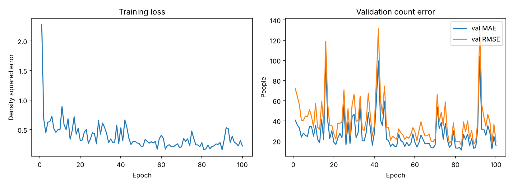

# Model and Training (draft — Ronish)

## Model: CSRNet
We implement CSRNet (Li et al., CVPR 2018) in TensorFlow/Keras (`src/model.py`).
The network maps an RGB image of any size to a density map at 1/8 of the input
resolution; the sum of that map is the predicted head count.

| Stage | Layers | Output size |
|-------|--------|-------------|
| Front end | First 10 conv layers of VGG16 (3×3, ReLU) with 3 max-pools, ImageNet weights | H/8 × W/8 × 512 |
| Back end | 6 dilated 3×3 convs (512, 512, 512, 256, 128, 64 filters; dilation rate 2; ReLU) | H/8 × W/8 × 64 |
| Output | 1×1 conv, 1 filter, ReLU | H/8 × W/8 × 1 |

- **Why VGG16:** the pretrained front end already extracts good low-level
  features, so training needs far fewer images and epochs than training from scratch.
- **Why dilated convolutions:** dilation rate 2 widens each layer's receptive
  field without adding pooling, so the output keeps 1/8 resolution and the
  network sees enough context to tell heads apart in a crowd.
- **Why ReLU on the output:** density can't be negative.
- The network is fully convolutional, so it accepts any input size. It has
  about 16.3 M trainable parameters. Back-end weights are initialised from
  N(0, 0.01²).

## Training setup (`src/train.py`)

| Setting | Value |
|---------|-------|
| Data | ShanghaiTech Part B, 360 train / 40 val images |
| Input | random 384 × 512 crops (1/4 of the image area), random horizontal flip |
| Target | ground-truth density map, sum-pooled 8 × 8 to match the output size |
| Loss | pixel-wise squared error, summed over each map and averaged over the batch |
| Optimizer | Adam, learning rate 1e-5 |
| Batch size | 8 |
| Epochs | up to 100, early stopping (patience 20) on validation MAE |
| Model selection | checkpoint with the lowest validation count MAE |
| Hardware | Google Colab, NVIDIA T4 GPU, ~40 s per epoch |
| Total training time | about 66 minutes (100 epochs), well within the 4 GPU-hour budget |

**Loss choice.** We sum the squared error over the pixels of each map instead
of averaging it. Density values are tiny (a 384 × 512 crop with 30 people has
a mean value of about 0.01 at 1/8 resolution), so a per-pixel mean gives
gradients so small that at lr 1e-5 the model tends to collapse to predicting
all zeros. Summing matches the loss used in the CSRNet paper.

**Validation metric.** Pixel loss is not what we care about, so after every
epoch a callback runs the model on the 40 full-size validation images and
computes the count MAE and RMSE (|predicted sum − true sum|). Checkpointing,
early stopping and the CSV log all use this count MAE.

## Training results

- Training ran the full 100 epochs. Early stopping never triggered, because
  validation MAE kept reaching new lows until epoch 83.
- Best validation MAE: **11.13** (RMSE **15.63**) at epoch **83**. This is the
  checkpoint we keep (`csrnet_partB_best.weights.h5`).
- On the 316 test images this checkpoint scores **MAE 11.78, RMSE 17.43**
  (MSE 303.83), compared with MAE 71.44 / RMSE 95.18 for the mean-count baseline
  and MAE 10.6 / RMSE 16.0 reported in the CSRNet paper (full results in the
  Results section).
- The training loss falls steadily, but validation MAE jumps a lot from epoch
  to epoch. The validation set has only 40 images, so a few badly counted
  images move the average a lot, and we use a constant learning rate with no
  decay. Selecting the checkpoint with the best validation MAE protects us
  from these swings.

## Limitations and possible improvements
- Learning-rate decay (or a lower rate later in training) would likely
  smooth the validation curve and give a better final model.
- A larger validation split would make model selection less noisy.
- We train on Part B only. Part A has much denser crowds; its
  geometry-adaptive density maps are already implemented, but it would need
  longer training.

## Credits
Architecture from Li, Zhang and Chen, "CSRNet: Dilated Convolutional Neural
Networks for Understanding the Highly Congested Scenes", CVPR 2018. Our Keras
code is our own; public implementations were used as reference only (see README).
