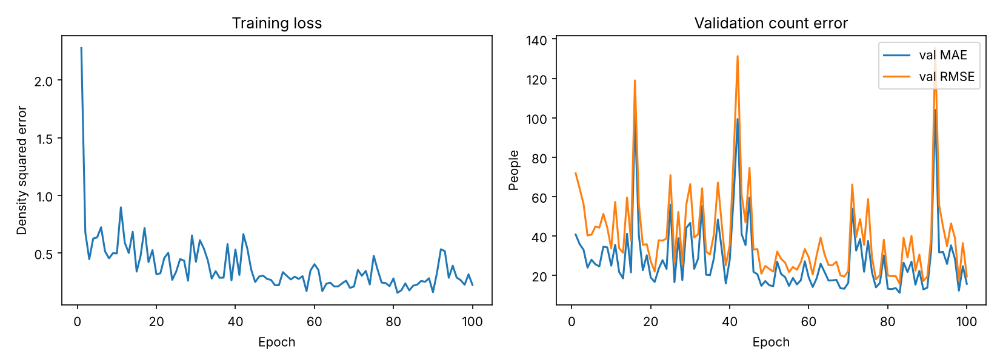

# Crowd Counting and Density Estimation with CSRNet

**Team CrowdStrike:** Prashant Panta, Ronish Karki, Prajwal Kunwar

Code: https://github.com/Prajwal382/CrowdStrike

## Introduction

Crowd counting estimates how many people appear in an image. It matters for
public safety, event management and urban planning, where counting by hand is
slow and detecting every person fails once people overlap in dense scenes.

We follow the density-estimation approach: instead of detecting people, a
network predicts a **density map** whose values sum to the number of people in
the image. This handles occlusion and perspective better than detection,
because the model only has to say how much "person" is in each region.

We implement **CSRNet** (Li, Zhang and Chen, CVPR 2018) in TensorFlow/Keras and
train it on **ShanghaiTech Part B**. The project has three parts, each owned by
one team member:

1. **Data pipeline** (Prashant Panta): ground-truth density maps, validation
   split and the `tf.data` loader.
2. **Model and training** (Ronish Karki): CSRNet and training on Google Colab.
3. **Evaluation and inference** (Prajwal Kunwar): MAE/MSE/RMSE evaluation, a
   mean-count baseline, and an inference script that draws a density heatmap
   on any image.

On the 316 Part B test images our model reaches **MAE 11.78** and
**RMSE 17.43**, compared with 71.44 / 95.18 for a mean-count baseline and
10.6 / 16.0 reported in the CSRNet paper.

## Dataset and Preprocessing

### Dataset
We use the ShanghaiTech Crowd Counting Dataset (Zhang et al., CVPR 2016).
Each image comes with a `.mat` file listing one (x, y) point per annotated head.

| Part | Train | Test | Typical scene | Resolution |
|------|------:|-----:|---------------|------------|
| B (required) | 400 | 316 | street scenes, sparser crowds | 768 × 1024 |
| A (stretch)  | 300 | 182 | dense crowds from the web | varies |

We hold out 10% of the official training images as a validation split
(Part B: 360 train / 40 val) with a fixed random seed (42), so every teammate
and every Colab run uses the same split. The ids are saved in
`data/processed/part_B/splits.json`. The test set is used only for final evaluation.

### Ground-truth density maps
Counting is framed as density regression. Each head point is replaced by a
2-D Gaussian kernel that integrates to 1, so the integral (sum) of the map
equals the head count.

- **Part B:** fixed kernel, σ = 15 px. Part B crowds are fairly uniform in
  scale, so a fixed σ works well (as in CSRNet).
- **Part A:** geometry-adaptive kernel. σᵢ = β · d̄ᵢ, where d̄ᵢ is the mean
  distance to the k = 3 nearest heads (via `scipy.spatial.KDTree`) and β = 0.3.
  Denser regions get narrower kernels.

Kernels are truncated at 3σ. Heads near the border would normally lose part
of their mass outside the image, which lowers the count. We clip each kernel
to the image and renormalise it, so every head still contributes exactly 1.
The generation script checks that every map satisfies
|sum − count| / count < 10⁻³ and refuses to save a map that fails.
Maps are stored as float32 `.npy` files at full image resolution.

### Input pipeline (`tf.data`)
- **Training:** random crop of 1/4 of the image area (half height × half
  width, i.e. 384 × 512 on Part B), random horizontal flip (p = 0.5),
  applied identically to the image and its density map.
- **Validation/test:** full image, zero-padded on the bottom and right to a
  multiple of 8. Padding adds no density, so counts are unchanged.
- **Normalisation:** RGB scaled to [0, 1], then standardised with the ImageNet
  mean (0.485, 0.456, 0.406) and std (0.229, 0.224, 0.225) to match the
  pretrained VGG-16 front end.
- **Target resolution:** CSRNet outputs a map at 1/8 resolution. We
  downsample the ground truth by **sum-pooling** 8 × 8 blocks, not by
  resizing. Sum-pooling preserves the total count exactly, while bilinear
  resizing would scale it by 1/64.

### Verification
- Unit tests check the count invariant, including heads on or outside
  the image border, and that the split is deterministic and disjoint. They
  also check loader shapes and dtypes, and that the 1/8 targets keep the count.
- A test on 20 random real Part B images checks that each density sum
  matches the number of annotated heads.
- `outputs/figures/density_examples.png` shows 6 image/density pairs.

## Model and Training

### Model: CSRNet
We implement CSRNet (Li et al., CVPR 2018) in TensorFlow/Keras (`src/model.py`).
The network maps an RGB image of any size to a density map at 1/8 of the input
resolution; the sum of that map is the predicted head count.

| Stage | Layers | Output size |
|-------|--------|-------------|
| Front end | First 10 conv layers of VGG16 (3×3, ReLU) with 3 max-pools, ImageNet weights | H/8 × W/8 × 512 |
| Back end | 6 dilated 3×3 convs (512, 512, 512, 256, 128, 64 filters; dilation rate 2; ReLU) | H/8 × W/8 × 64 |
| Output | 1×1 conv, 1 filter, ReLU | H/8 × W/8 × 1 |

- **Why VGG16:** the pretrained front end already extracts good low-level
  features, so training needs far fewer images and epochs than training from scratch.
- **Why dilated convolutions:** dilation rate 2 widens each layer's receptive
  field without adding pooling, so the output keeps 1/8 resolution and the
  network sees enough context to tell heads apart in a crowd.
- **Why ReLU on the output:** density can't be negative.
- The network is fully convolutional, so it accepts any input size. It has
  about 16.3 M trainable parameters. Back-end weights are initialised from
  N(0, 0.01²).

### Training setup (`src/train.py`)

| Setting | Value |
|---------|-------|
| Data | ShanghaiTech Part B, 360 train / 40 val images |
| Input | random 384 × 512 crops (1/4 of the image area), random horizontal flip |
| Target | ground-truth density map, sum-pooled 8 × 8 to match the output size |
| Loss | pixel-wise squared error, summed over each map and averaged over the batch |
| Optimizer | Adam, learning rate 1e-5 |
| Batch size | 8 |
| Epochs | up to 100, early stopping (patience 20) on validation MAE |
| Model selection | checkpoint with the lowest validation count MAE |
| Hardware | Google Colab, NVIDIA T4 GPU, ~40 s per epoch |
| Total training time | about 66 minutes (100 epochs), well within the 4 GPU-hour budget |

**Loss choice.** We sum the squared error over the pixels of each map instead
of averaging it. Density values are tiny (a 384 × 512 crop with 30 people has
a mean value of about 0.01 at 1/8 resolution), so a per-pixel mean gives
gradients so small that at lr 1e-5 the model tends to collapse to predicting
all zeros. Summing matches the loss used in the CSRNet paper.

**Validation metric.** Pixel loss is not what we care about, so after every
epoch a callback runs the model on the 40 full-size validation images and
computes the count MAE and RMSE (|predicted sum − true sum|). Checkpointing,
early stopping and the CSV log all use this count MAE.

### Training results

- Training ran the full 100 epochs. Early stopping never triggered, because
  validation MAE kept reaching new lows until epoch 83.
- Best validation MAE: **11.13** (RMSE **15.63**) at epoch **83**. This is the
  checkpoint we keep (`csrnet_partB_best.weights.h5`).
- On the 316 test images this checkpoint scores **MAE 11.78, RMSE 17.43**
  (MSE 303.83), compared with MAE 71.44 / RMSE 95.18 for the mean-count baseline
  and MAE 10.6 / RMSE 16.0 reported in the CSRNet paper (full results in the
  Results section).
- The training loss falls steadily, but validation MAE jumps a lot from epoch
  to epoch. The validation set has only 40 images, so a few badly counted
  images move the average a lot, and we use a constant learning rate with no
  decay. Selecting the checkpoint with the best validation MAE protects us
  from these swings.

### Limitations and possible improvements
- Learning-rate decay (or a lower rate later in training) would likely
  smooth the validation curve and give a better final model.
- A larger validation split would make model selection less noisy.
- We train on Part B only; Part A has much denser crowds and would need the
  geometry-adaptive density maps and longer training.

## Results

### Metrics
For each test image we sum the predicted density map to get a count and compare
it with the number of annotated heads. Over the N = 316 Part B test images:

- **MAE** = mean |pred − gt|
- **MSE** = mean (pred − gt)²
- **RMSE** = √MSE

Crowd-counting papers, including CSRNet, report RMSE under the name "MSE". We
report both and label them, so our numbers can be compared with the paper's.

### Baseline
To give the numbers context, the baseline ignores the image and predicts the
same count for every test image: the mean count of the 360 training images,
**120.84** people. It is computed from the training density maps
(`python src/evaluate.py --baseline`) and was cross-checked against counts read
directly from the `.mat` annotation files.

### Test results (ShanghaiTech Part B, 316 test images)

| Method | MAE | MSE | RMSE |
|---|---:|---:|---:|
| Mean-count baseline | 71.44 | 9058.92 | 95.18 |
| **CSRNet (ours)** | **11.78** | **303.83** | **17.43** |
| CSRNet (paper, Li et al. 2018) | 10.6 | n/a | 16.0 |

Our model uses the checkpoint with the best validation MAE (11.13, RMSE 15.63,
epoch 83 of 100; see the Model and Training section). The test set was not used
for any training or model-selection decision.

- **Against the baseline:** CSRNet cuts the MAE from 71.44 to 11.78, about 6×
  lower, and the RMSE from 95.18 to 17.43. The model is clearly counting people,
  not just learning the average crowd size.
- **Against the paper:** our MAE is 1.2 people higher (11.78 vs 10.6, about 11%)
  and our RMSE 1.4 higher (17.43 vs 16.0). That is close for a re-implementation
  trained for about 66 minutes on one T4 GPU with a constant learning rate and
  no schedule tuning.
- **RMSE vs MAE:** RMSE is about 1.5× the MAE. Squaring weights large misses
  heavily, so most of the error comes from a minority of images with large
  count errors rather than small errors spread evenly.

### Predicted vs ground-truth counts

_Figure pending: `outputs/figures/scatter_part_B_test.png`, produced by_
`python src/evaluate.py --weights checkpoints/csrnet_partB_best.weights.h5 --part B --split test`.

### Best and worst test images

_Figure pending: `outputs/figures/best_worst_part_B_test.png` (same command)._

### Qualitative results on new images

To check how the model behaves outside ShanghaiTech, we ran `src/predict.py` on
crowd photos from Unsplash (free licence; credits in the README). These images
have no ground truth, so they show behaviour, not accuracy.

_Figures pending: overlays in `outputs/figures/demo/`, produced by_
`python src/predict.py --weights checkpoints/csrnet_partB_best.weights.h5 --image demo_images/ --out outputs/figures/demo/`.

### Limitations of the evaluation
These add to the training limitations in the Model and Training section.

- **Single dataset part.** Results are for Part B only. Part A has much denser
  crowds, so these numbers say little about very dense scenes.
- **Domain shift.** Part B images come from fixed street cameras at a similar
  height and angle. Photos from other viewpoints, at night or with very
  different crowd densities are outside what the model saw in training, which
  is why the new-image results are qualitative only.

## Conclusion

We built a complete crowd-counting pipeline: border-safe Gaussian density maps
whose sums match the head counts, a `tf.data` loader that keeps counts exact
through augmentation and 1/8 sum-pooling, a Keras CSRNet trained on a single
Colab T4 GPU in about 66 minutes, and scripts that evaluate any checkpoint and
draw density heatmaps on new images.

On ShanghaiTech Part B the model reaches MAE 11.78 and RMSE 17.43 on the test
set. That is about 6× better than predicting the mean training count and close
to the published CSRNet result (MAE 10.6, RMSE 16.0).

The most promising next steps are a learning-rate schedule and a larger
validation split, to make training and model selection less noisy, and
training on Part A, which needs the geometry-adaptive density maps that are
already implemented.

## References

1. Y. Li, X. Zhang, D. Chen. CSRNet: Dilated Convolutional Neural Networks for
   Understanding the Highly Congested Scenes. CVPR 2018.
2. Y. Zhang, D. Zhou, S. Chen, S. Gao, Y. Ma. Single-Image Crowd Counting via
   Multi-Column Convolutional Neural Network. CVPR 2016 (ShanghaiTech dataset).
3. K. Simonyan, A. Zisserman. Very Deep Convolutional Networks for Large-Scale
   Image Recognition. ICLR 2015 (VGG-16).
