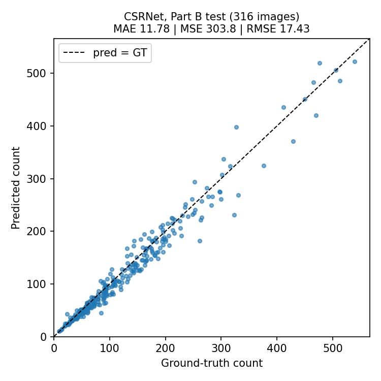
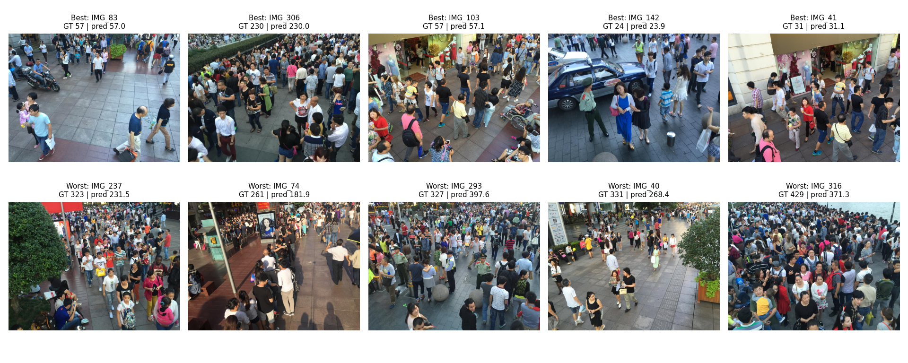
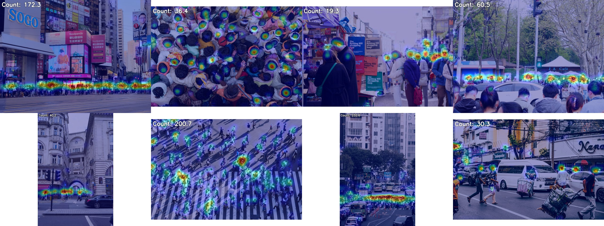

# Results (draft — Prajwal)

## Metrics
For each test image we sum the predicted density map to get a count and compare
it with the number of annotated heads. Over the N = 316 Part B test images:

- **MAE** = mean |pred − gt|
- **MSE** = mean (pred − gt)²
- **RMSE** = √MSE

Crowd-counting papers, including CSRNet, report RMSE under the name "MSE". We
report both and label them, so our numbers can be compared with the paper's.

## Baseline
To give the numbers context, the baseline ignores the image and predicts the
same count for every test image: the mean count of the 360 training images,
**120.84** people. It is computed from the training density maps
(`python src/evaluate.py --baseline`) and was cross-checked against counts read
directly from the `.mat` annotation files.

## Test results (ShanghaiTech Part B, 316 test images)

| Method | MAE | MSE | RMSE |
|---|---:|---:|---:|
| Mean-count baseline | 71.44 | 9058.92 | 95.18 |
| **CSRNet (ours)** | **11.78** | **303.83** | **17.43** |
| CSRNet (paper, Li et al. 2018) | 10.6 | n/a | 16.0 |

Our model uses the checkpoint with the best validation MAE (11.13, RMSE 15.63,
epoch 83 of 100; see the Model and Training section). The test set was not used
for any training or model-selection decision.

- **Against the baseline:** CSRNet cuts the MAE from 71.44 to 11.78, about 6×
  lower, and the RMSE from 95.18 to 17.43. The model is clearly counting people,
  not just learning the average crowd size.
- **Against the paper:** our MAE is 1.2 people higher (11.78 vs 10.6, about 11%)
  and our RMSE 1.4 higher (17.43 vs 16.0). That is close for a re-implementation
  trained for about 66 minutes on one T4 GPU with a constant learning rate and
  no schedule tuning.
- **RMSE vs MAE:** RMSE is about 1.5× the MAE. Squaring weights large misses
  heavily, so most of the error comes from a minority of images with large
  count errors rather than small errors spread evenly.

- **Bias:** the model undercounts on 228 of the 316 test images (72%). On
  average it predicts 117.75 people where there are 123.80, about 5% too few.

All test numbers were reproduced independently from the shared checkpoint
(`checkpoints/csrnet_partB_best.weights.h5`) with `src/evaluate.py`'s data
pipeline and plotting code, and match Ronish's run to two decimals.

## Predicted vs ground-truth counts

The points follow the diagonal closely (correlation 0.985 between predicted
and true counts). Below about 150 people the errors are small; above about 250
the spread widens and most large misses fall below the diagonal. The worst 10%
of images (32 of 316) account for 35% of the total absolute error.

## Best and worst test images

The five best images are counted almost exactly (errors of 0.1 people or less)
and range from 24 to 230 people, so the model is not only accurate on sparse
scenes. All five worst images are dense (261 to 429 people). Four of them are
undercounts by 58 to 92 people. In these scenes the people far from the camera
are very small and packed together, so their heads blur into each other at the
model's 1/8 output resolution. The one overcount (IMG_293: 397.6 vs 327) is a
dense plaza with many partly hidden people.

## Qualitative results on new images

To see how the model behaves outside ShanghaiTech, we ran `src/predict.py` on
eight crowd photos from Unsplash (free licence; credits in the README). The
photos were shrunk so their longest side is 1024 pixels, the width of a Part B
image (`--max-side 1024`, the default). They have no ground truth, so this
shows behaviour, not accuracy.

Individual overlays and counts: `outputs/figures/demo/`.

- **Similar viewpoint to Part B works best.** On raised street views where
  heads are roughly the size seen in training (Shanghai crossing, Notting Hill
  market, Bangkok street), the heatmap sits on the visible heads and the counts
  look plausible.
- **Overhead views with large heads are undercounted.** The festival crowd shot
  from directly above gives 36.4, although clearly more people are visible. Each
  head is several times larger than in Part B, and the model spreads less than
  one person's worth of density over it.
- **Distant bands of texture can be overcounted.** In the Ginza (232.6) and
  sparse London (40.2) photos, the heatmap forms a horizontal band along the far
  end of the street, including vehicles and building fronts, which inflates the
  count.

These failures match the dataset: Part B contains only raised, oblique street
views with a narrow range of head sizes. Training with scale augmentation, or
on Part A's more varied images, would be the first steps to handle other
viewpoints.

## Limitations of the evaluation
These add to the training limitations in the Model and Training section.

- **Single dataset part.** Results are for Part B only. Part A has much denser
  crowds, so these numbers say little about very dense scenes.
- **Domain shift.** Part B images come from fixed street cameras at a similar
  height and angle. Photos from other viewpoints, at night or with very
  different crowd densities are outside what the model saw in training, which
  is why the new-image results are qualitative only.
